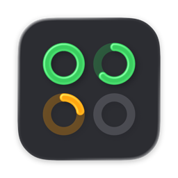
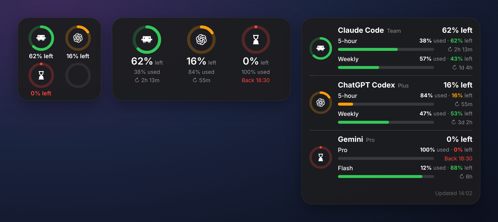
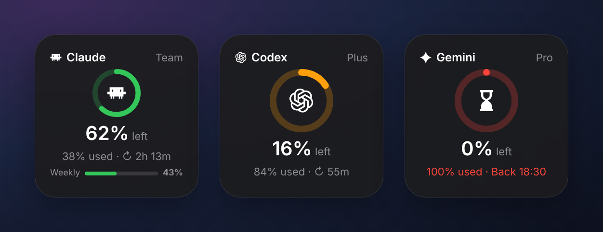
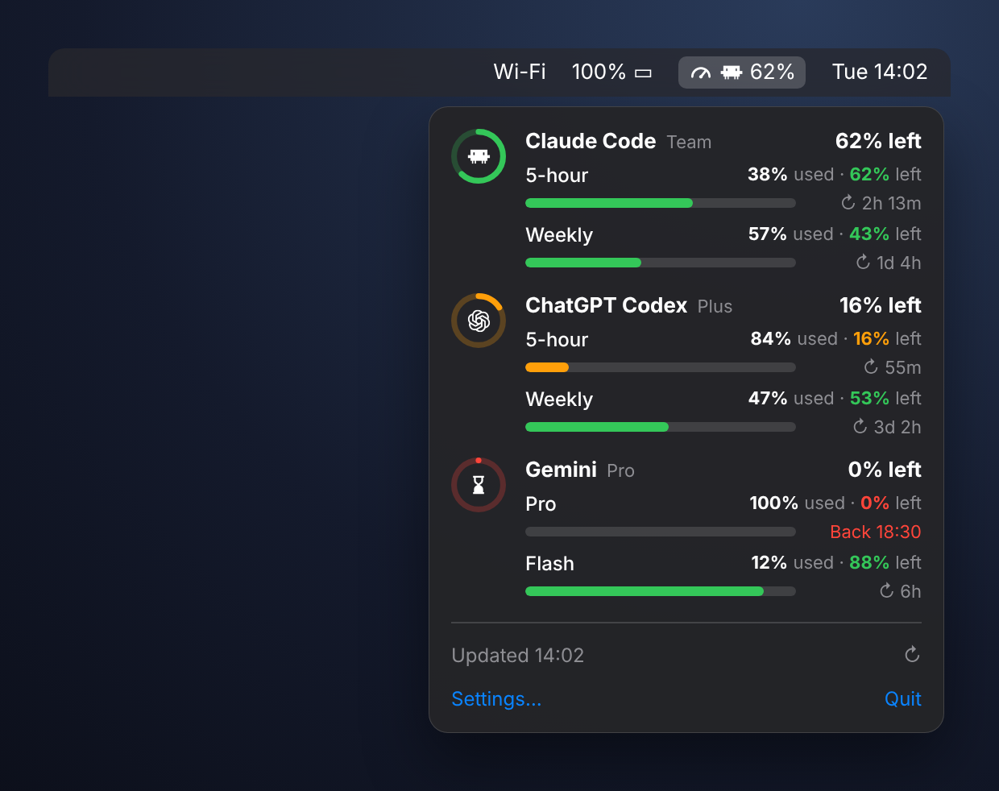

<p align="center">
  
</p>

<h1 align="center">AI Limits</h1>

<p align="center">
  Your <b>Claude Code</b>, <b>ChatGPT Codex</b> and <b>Gemini</b> usage limits at a glance, as macOS widgets in the style of Batteries and a menu bar indicator.
</p>

<p align="center">
  <a href="https://github.com/robertlevonyan/ai-limits/releases/latest"><b>Download the latest release</b></a>
</p>

---



## Features

- **Batteries-style widgets.** Small, medium and large widgets show how much of each limit is left, with a ring per tool.
- **One widget per AI.** Small widgets for Claude Code, Codex and Gemini on their own. The Claude widget also shows a weekly bar.
- **Menu bar indicator.** Pick one tool to show its percentage next to the icon. Click it for every limit and its reset time.
- **When it comes back.** Shows a countdown to each reset, or the exact time once a limit is used up.
- **Honest numbers.** Rings turn orange at 25% left and red at 10%. Numbers from a failed refresh are marked **Not updating** rather than shown as current.
- **Fast refresh.** As often as every 5 seconds. Each service is still asked no more often than it allows.
- **No extra logins.** Reads the logins your tools already have: Claude Code, the Codex CLI, and Antigravity or the Gemini CLI.

<p align="center">
  
</p>

<p align="center">
  
</p>

> The images above are rendered from the app's layouts with sample data.

## Install

1. Download `AI-Limits-<version>.dmg` from [Releases](https://github.com/robertlevonyan/ai-limits/releases/latest).
2. Open it and drag **AI Limits** into **Applications**.
3. The first time, **right-click › Open** the app. Current builds aren't notarized yet. If macOS says the app is damaged, run:
   ```bash
   xattr -dr com.apple.quarantine "/Applications/AI Limits.app"
   ```
4. Right-click the desktop › **Edit Widgets** › **AI Limits**, and add the widgets you like.

Requires macOS 14 Sonoma or later.

## Where the numbers come from

| Tool | Default source | Other options in Settings |
|---|---|---|
| **Claude Code** | Your Claude Code login (Keychain item `Claude Code-credentials`). The app renews it when it expires and saves it back, so Claude Code stays signed in. | claude.ai browser session (`sessionKey` cookie), or a pasted OAuth token |
| **ChatGPT Codex** | `~/.codex/auth.json` from `codex login`. Falls back to the limits in your latest Codex session log. | Session logs only (offline), or a pasted access token |
| **Gemini** | The running **Antigravity** app (its own live quota). Falls back to Antigravity's saved login, then the Gemini CLI (`~/.gemini/oauth_creds.json`). | Antigravity only, Gemini CLI only, or a pasted Google token |

The first time it reads the Claude Code login, macOS asks for permission. Choose **Always Allow**.

These are the same endpoints the official tools use. They aren't public APIs and may change without notice.

## Settings

Click the gauge in the menu bar and choose **Settings…**, or click the app's Dock icon.

- **Show in menu bar.** Icon only, or a tool's percentage left.
- **Percentages show.** What's left (Batteries style) or what's used (like Claude's `/usage`).
- **Refresh every.** From 5 seconds to 30 minutes.
- **Show icon in Dock** and **Launch at login**.
- **Per tool.** Turn it on or off, pick its source, and see a status line with what the last refresh returned.
- **Run diagnostics.** Saves a report to `~/Downloads/AILimits-diagnostics.txt`. It contains raw usage responses and yes/no checks, never tokens.

Pasted tokens and cookies are kept in your login Keychain.

## Build from source

1. Open `AILimits.xcodeproj` in **Xcode 26** or later.
2. Under **Signing & Capabilities**, set your team for both targets. Both use the App Group `$(TeamIdentifierPrefix)com.robertlevonyan.ailimits`.
3. Run the **AILimits** scheme (⌘R).

The project uses folder-synced groups, so files you add to `App/`, `Widget/` or `Shared/` are picked up automatically. After each Debug build, the scheme registers that build's widgets and removes other copies, so the widget list never shows duplicates.

```
App/      Menu bar app: settings, refresh service, fetchers (Claude, Codex, Gemini/Antigravity)
Widget/   WidgetKit extension: combined widget (S/M/L) and per-AI widgets (S)
Shared/   Models, App Group store, ring and bar views, logos
Config/   Info.plists and entitlements
scripts/  make-dmg.sh
```

If a widget looks stale after a rebuild, remove it from the desktop and add it again, or run `killall chronod NotificationCenter`.

## Releases

Releases are built by GitHub Actions (`.github/workflows/release.yml`) on a macOS runner:

```bash
git tag v1.0.0
git push origin v1.0.0
```

A few minutes later, `AI-Limits-1.0.0.dmg` shows up under **Releases**. You can also run it by hand from **Actions › Release › Run workflow**.

Without an Apple Developer ID the build is unsigned. To ship signed and notarized builds, add these repository secrets: `DEVELOPER_ID_P12_BASE64`, `DEVELOPER_ID_P12_PASSWORD`, `APPLE_TEAM_ID`, `APPLE_ID` and `APPLE_APP_PASSWORD`. The workflow uses them automatically.

## Privacy

Everything runs on your Mac. The app talks only to the services it measures (Anthropic, OpenAI and Google) and to Antigravity on `localhost`. It has no analytics or tracking.

## Disclaimer

AI Limits is an independent project, not affiliated with or endorsed by Anthropic, OpenAI or Google. Claude, ChatGPT, Codex, Gemini and Antigravity are trademarks of their respective owners.
